# INDOP-MA: Multi-Node Spatial Evaluation and Distributed INDOP

**Calibration-free spectrum occupancy across seven POWDER nodes, and a multi-agent extension that lets those nodes cooperate before reporting to OpenZMS.**

This repository holds *Contribution 6* of the paper **"INDOP: Calibration-Free Spectrum Occupancy Estimation Using Unsupervised Learning on Raw IQ Data"** (MobiCom '27 submission). It contains:

* a working implementation of the single-node INDOP pipeline (`indop/`);
* the INDOP-MA multi-agent layer (`indop_ma/`): noise-floor consensus, joint occupancy fusion, spatial maps and cooperative cyclostationary detection;
* on-node capture and campaign tooling for the POWDER testbed (`scripts/capture_uhd.py`, `scripts/run_multinode_campaign.py`);
* a simulator with known ground truth (`sim/`) and experiments for each of the four proposed extensions;
* figures, architecture diagrams and documentation (`docs/`).

> **Real vs synthetic.** Figures 1–6 use only the measured POWDER results published in the paper (transcribed in [`data/paper_results/`](data/paper_results/)). Figures 7 and 10–15 come from the **synthetic simulator** and are stamped *SYNTHETIC*. They show how the INDOP-MA algorithms behave and set up the experiments; they are not measurements. Every synthetic experiment has a `--npz-dir` (or similar) path that reruns the same analysis on real node outputs.

---

## What this contribution does

INDOP ran **simultaneously on seven geographically distributed POWDER nodes** (Sagepoint, Web, Guesthouse, Moran, Madsen, Law73, EBC), all monitoring **CBRS 3595 MHz**. This is the first multi-location evaluation of a calibration-free occupancy estimator on a real urban testbed.

* **4 of 5 validated nodes are within ±2.5 pp** of physics ground truth, with **no calibration table on any node**.
* **The spatial variation is physically meaningful.** Nodes with a stronger received signal from the CBRS transmitter report higher occupancy.
* **Guesthouse shows a +5.1 pp gap.** This repository proposes two concrete mechanisms for it and a test to tell them apart (see [INDOP-MA consensus](docs/INDOP_MA.md#form-1-noise-floor-consensus)).

**Why it matters.** Single-node occupancy tells you what one point sees. Multi-node occupancy tells the Zone Management Controller *whether the band is idle at the location where a consumer wants to transmit*. That enables **location-aware spectrum grants**, which the current OpenZMS fixed-threshold DST cannot make.

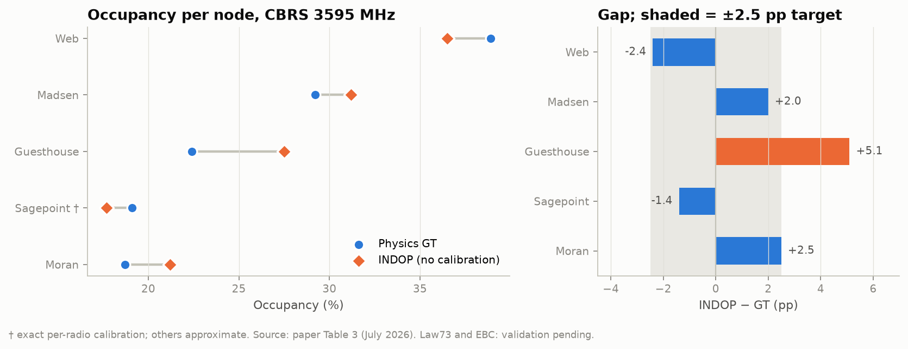

| Node | Location | INDOP (%) | Physics GT (%) | Gap (pp) |
|---|---|---:|---:|---:|
| Sagepoint † | Engineering | 17.7 | 19.1 | −1.4 ✓ |
| Web | Web building | 36.5 | 38.9 | −2.4 ✓ |
| Guesthouse | Guesthouse | 27.5 | 22.4 | +5.1 |
| Moran | Moran bldg. | 21.2 | 18.7 | +2.5 ✓ |
| Madsen | Madsen bldg. | 31.2 | 29.2 | +2.0 ✓ |
| Law73, EBC | — | deployed | pending | — |

† Exact per-radio calibration. Others use approximate calibration. Source: paper Table 3, July 2026.

---

## Architecture

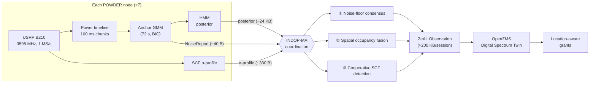

Raw IQ (5.4 GB per node per session) **never leaves the node**. Detailed diagrams, the coordination sequence and the message budget are in **[docs/ARCHITECTURE.md](docs/ARCHITECTURE.md)**.

---

## INDOP-MA in one table

| Form | What agents share | What it buys | Code |
|---|---|---|---|
| ① Noise-floor consensus | GMM noise-cluster stats + post-anchor reference | Robustness to unlucky anchor windows; a test of the Guesthouse anomaly | `indop_ma/consensus.py` |
| ② Spatial occupancy fusion | Per-chunk HMM posteriors, node locations | Location-aware occupancy, DST proxel maps, fusion rules for grants | `indop_ma/fusion.py`, `indop_ma/spatial_map.py` |
| ③ Cooperative cyclostationary detection | SCF α-profiles | Confirms weak LTE that no single node can attribute | `indop_ma/coop_cyclo.py` |

---

## Key findings so far

### Measured (paper)

| | |
|---|---|
| 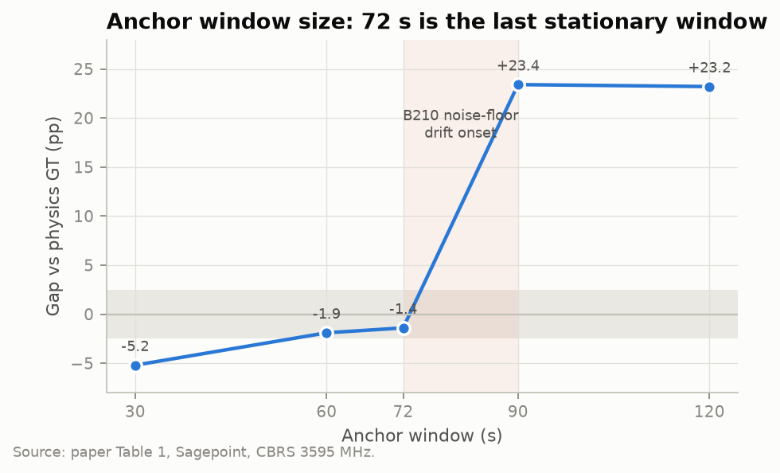 | 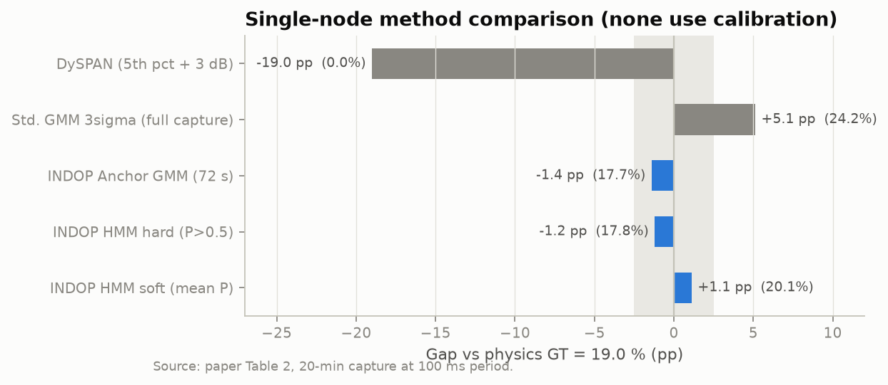 |
| The 72 s anchor is the last stationary window. B210 drift between 72 and 90 s pushes the gap to +23 pp. | INDOP is within 1.1–1.4 pp of physics GT. The 5th-percentile + 3 dB baseline misses by 19 pp. |
| 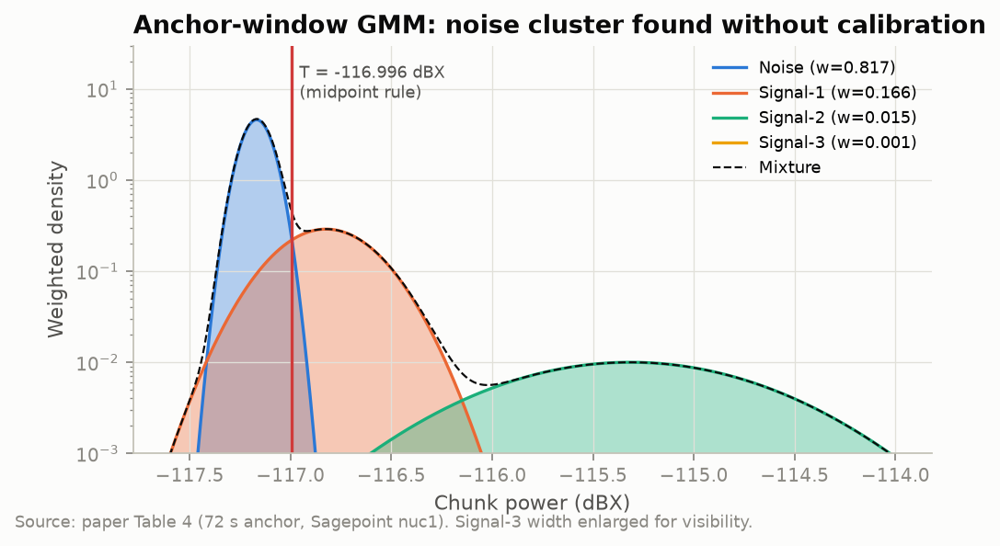 | 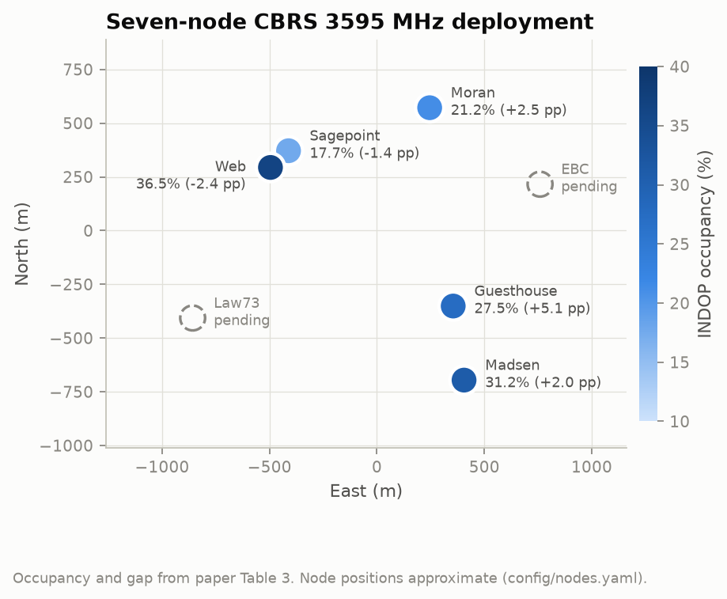 |
| A clean noise cluster (σ = 0.071 dB, weight 81.7 %) appears at 100 ms resolution. | The seven-node deployment. Node positions are approximate. |

### Synthetic (INDOP-MA design studies)

**① Noise-floor consensus and the Guesthouse gap** ([fig10](docs/figures/fig10_consensus_guesthouse.png))

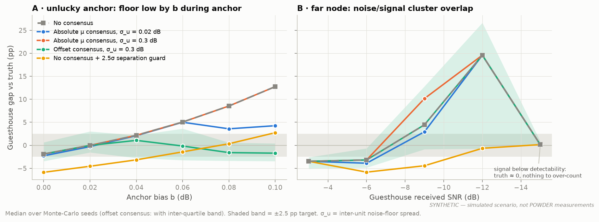

* An anchor-window bias of **0.06 dB** is enough to produce a **+5 pp** gap, the size of the Guesthouse anomaly.
* **Offset consensus** compares each node's anchor noise mean with its own post-anchor re-estimate. It keeps the faulty node within ±2.5 pp for biases up to 0.10 dB, even with 0.3 dB of hardware spread between units.
* **Absolute** noise-floor consensus works only when the units' hardware offsets are nearly identical.
* Consensus on the detection margin was **rejected**: it flags the healthy high-SNR nodes instead of the faulty one.
* **Consensus cannot fix a far, low-SNR node** whose signal cluster overlaps the noise cluster. A 2.5σ separation guard does fix it.

**② Fusion rules for grants** ([fig11](docs/figures/fig11_fusion_rules.png)). OR gives 0.0 % false grants and is the rule for **incumbent protection**. Location-weighted fusion at τ = 0.3 gives 1.6 % false grants at 94.6 % utilisation, which is the best trade-off for **DSA scheduling**. AND is unsafe: it produces 45.6 % false grants.

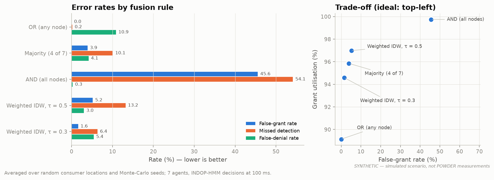

**② Spatial maps** ([fig12](docs/figures/fig12_spatial_occupancy_maps.png)). Seven calibration-free INDOP agents at 100 ms, interpolated with a GP, reach a **2.5 pp map MAE**. A single fixed threshold applied to 3 s sweeps reaches **7.4 pp**, and its per-node error is **27 pp**.

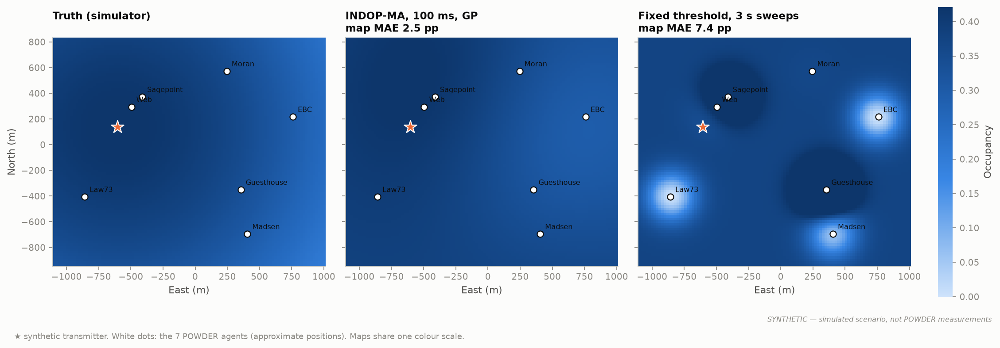

**③ Cooperative cyclostationary detection** ([fig14](docs/figures/fig14_cooperative_scf.png)). Averaging the α-profiles of seven nodes moves the 90 % detection point to a lower per-node SNR at the same 5 % false-alarm rate.

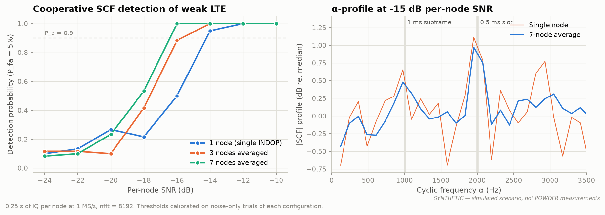

**Temporal campaign: the 4–7 am carrier idle window** ([fig15](docs/figures/fig15_temporal_idle_window.png)). With hourly 20-minute sessions on all seven agents, INDOP marks exactly 04–06 h as idle at every node.

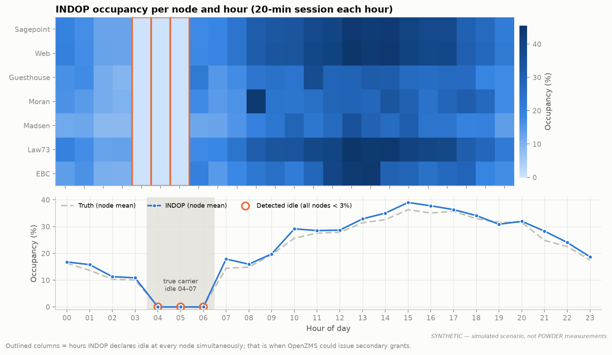

Full numbers and caveats: **[docs/RESULTS.md](docs/RESULTS.md)**.

---

## Extending the contribution: the four experiments

| # | Extension | Status | How to run |
|---|---|---|---|
| 1 | **Temporal campaign**: morning, afternoon, evening and night sessions. Does INDOP see the 4–7 am idle window passively on all seven nodes? | Tooling and synthetic study done; POWDER sessions to schedule | `capture_uhd.py --session HH` on each node, then `run_temporal_campaign.py --npz-dir` |
| 2 | **Noise-floor consensus vs the Guesthouse +5.1 pp gap** | Algorithm implemented; synthetic study done; real-data check is one command | `run_consensus_experiment.py --npz-dir results/npz` |
| 3 | **Spatial map vs OpenZMS Figure 7**: calibration-free, adaptive per node, 100 ms instead of periodic sweeps | GP and IDW maps implemented; DST export loader ready | `run_spatial_map.py --dst-csv dst.csv` |
| 4 | **Fusion rules**: OR for incumbents, weighted for DSA. Which minimises false grants and missed detections? | Implemented and evaluated (synthetic) | `run_fusion_experiment.py` |

The step-by-step POWDER protocol is in **[docs/REPRODUCIBILITY.md](docs/REPRODUCIBILITY.md)**, and the experiment design rationale is in **[docs/EXPERIMENTS.md](docs/EXPERIMENTS.md)**.

---

## Quick start

```bash
pip install -r requirements.txt
pytest                                                  # 20 tests
python scripts/plot_paper_figures.py                    # measured-result figures
python scripts/run_multinode_campaign.py --synthetic    # 7 agents + consensus + ZeAL payload
make figures                                            # every figure (~20 min)
```

Minimal API (sketch; `power_timeline_of`, `node_xy` and `consumer_xy` come from your own data):

```python
import numpy as np
from indop import run_indop
from indop_ma import NoiseReport, noise_floor_consensus, fuse, idw_weights

results = [run_indop(power_timeline_of[node], node) for node in nodes]   # per agent
reports = [NoiseReport.from_fit(r.node, r.gmm, r.meta["mu_ref_dbx"]) for r in results]
cons    = noise_floor_consensus(reports, mode="offset")                  # ① consensus
probs   = np.vstack([r.hmm.posterior for r in results])
busy_at_c = fuse("weighted", probs > 0.5, probs=probs,
                 weights=idw_weights(node_xy, consumer_xy), tau=0.3)     # ② fusion
```

On a POWDER node:

```bash
python scripts/capture_uhd.py --node Web --minutes 20 --session 05 --out results/npz
```

---

## Repository layout

```
indop/          single-node INDOP: power timeline, anchor GMM, HMM, SCF, physics GT, baselines
indop_ma/       INDOP-MA: topology, consensus, fusion, spatial maps, cooperative SCF, ZeAL payloads
sim/            synthetic multi-node CBRS scenario with ground truth
scripts/        capture, campaign runner, experiments, figure generation
config/         nodes.yaml: the 7 POWDER nodes and campaign parameters
data/           paper_results/: published measurements (Tables 1–4, SCF peaks)
results/        CSV/JSON outputs of the experiments
docs/           ARCHITECTURE, METHODOLOGY, INDOP_MA, EXPERIMENTS, RESULTS, REPRODUCIBILITY, figures/
tests/          pytest suite
```

## Documentation

* [Architecture](docs/ARCHITECTURE.md): system, pipeline and coordination diagrams, message budget, design decisions
* [Methodology](docs/METHODOLOGY.md): every equation for INDOP and INDOP-MA, and the simulator model
* [INDOP-MA design](docs/INDOP_MA.md): the three communication forms, including which designs failed and why
* [Experiments](docs/EXPERIMENTS.md): hypotheses, protocols and success criteria for the four extensions
* [Results](docs/RESULTS.md): measured and synthetic results with caveats
* [Reproducibility](docs/REPRODUCIBILITY.md): local runs and the POWDER deployment protocol

## Limitations

* The node coordinates in `config/nodes.yaml` are **approximate**. Replace them with surveyed POWDER positions before publishing any map.
* Physics GT is exact only for Sagepoint (serial 31722B7). Calibration constants for the other B210s should be added to `indop/ground_truth.py` as they are measured.
* The ZeAL payload field names are illustrative. Map them to the deployment's OpenZMS client.
* `capture_uhd.py` follows the UHD Python API but has not been run in CI, which has no radio. Test it on one node before a campaign.
* Synthetic results depend on simulator assumptions (path loss, burst model, drift). They are design evidence, not substitutes for the POWDER campaign.

## Citation

See [`CITATION.cff`](CITATION.cff). Please also cite the INDOP paper and the POWDER and OpenZMS (POWDER-RDZ) papers it builds on.

## Acknowledgements

Experiments use the [POWDER](https://powderwireless.net) wireless testbed at the University of Utah. OpenZMS / POWDER-RDZ is by Johnson et al.

## License

MIT. See [LICENSE](LICENSE).
