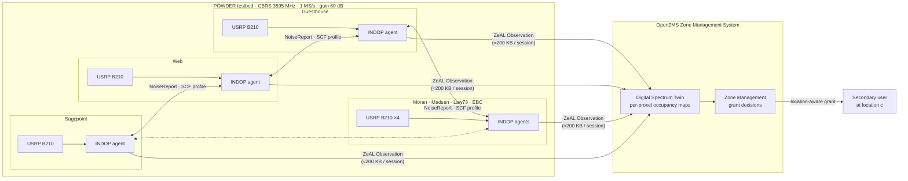
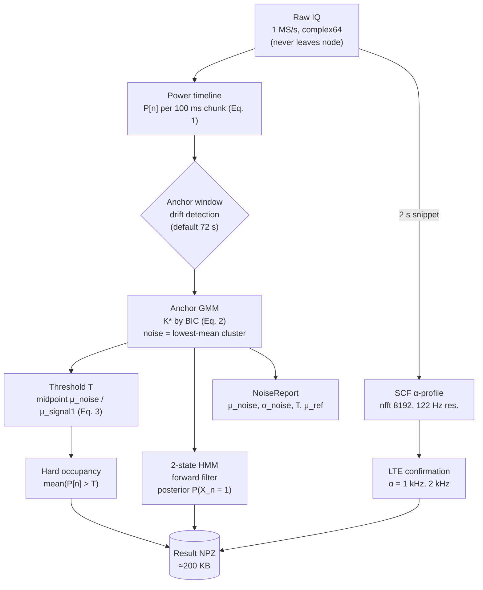
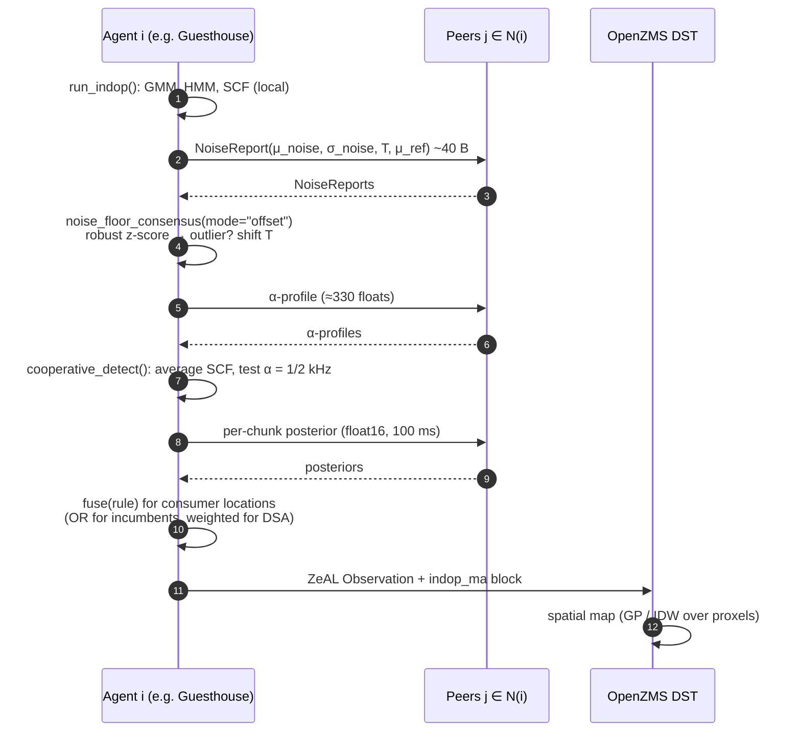

# Architecture

INDOP-MA has three layers. Raw IQ stays on the node in all of them.

1. **INDOP agent (per node).** It runs the calibration-free single-node pipeline next to the radio.
2. **INDOP-MA coordination.** Agents exchange compact summaries with their peers before they report.
3. **OpenZMS integration.** Each agent posts a ZeAL-compliant occupancy Observation to the Digital Spectrum Twin (DST).

## 1. System overview



## 2. Per-node INDOP pipeline



Code: `indop/power.py` → `indop/anchor_gmm.py` → `indop/hmm.py`, `indop/cyclo.py`, orchestrated by `indop/pipeline.py::run_indop`.

## 3. INDOP-MA coordination round

Each agent runs one coordination round per session, after its local pipeline finishes and before it reports to OpenZMS.



### Message budget per 20-minute session and agent

| Message | Size | Why it is enough |
|---|---|---|
| `NoiseReport` | 7 floats (~40 B) | Consensus needs only the noise-cluster statistics. |
| SCF α-profile up to 5 kHz | ~41 floats at 122 Hz (~330 B) | The LTE features sit at 1 kHz and 2 kHz. |
| HMM posterior | 12 000 × float16 (~24 KB) | Per-chunk fusion at 100 ms. |
| Result NPZ to DST | ≈200 KB | Matches the paper's backhaul budget. |
| Raw IQ (not sent) | 5.4 GB | Kept on the node. |

## 4. Repository map

```
indop/                 single-node INDOP (paper Secs. 3.2–3.5)
  power.py             Eq. 1 power timeline, streaming IQ readers
  anchor_gmm.py        Eq. 2–3 BIC-GMM, threshold, drift-detecting anchor selection
  hmm.py               2-state HMM forward filter
  cyclo.py             SCF α-profile, profile averaging
  ground_truth.py      Eq. 5 physics GT, self-calibrated fallback
  baselines.py         DySPAN 5th-pct+3 dB, full-capture GMM 3σ, fixed threshold
  pipeline.py          run_indop() → INDOPResult (.save_npz)
indop_ma/              multi-agent extension (paper Sec. 7)
  topology.py          node positions, distances, peer neighbourhoods
  consensus.py         noise-floor consensus (absolute / offset), gossip averaging
  fusion.py            OR / AND / k-of-n / weighted fusion, grant metrics
  spatial_map.py       IDW and GP proxel maps, DST export loader
  coop_cyclo.py        cooperative SCF detection
  zeal.py              OpenZMS ZeAL Observation payloads
sim/synthetic.py       synthetic multi-node scenario (truth known)
scripts/               capture, campaign runner, experiments, figures
config/nodes.yaml      the 7 POWDER nodes and campaign parameters
data/paper_results/    published numbers (Tables 1–4, SCF peaks)
docs/                  this documentation + figures/
tests/                 pytest suite
```

## 5. Design decisions

1. **Raw IQ stays on the node.** POWDER backhaul cannot carry 7 × 5.4 GB per session. Every message between agents is a summary statistic.
2. **INDOP-MA only adds to the existing interface.** Each agent still posts its own ZeAL Observation. Jointly derived fields go in an optional `indop_ma` block, which a DST that does not know INDOP-MA can ignore.
3. **The algorithms are robust to bad peers.** Consensus uses a weighted median and a modified z-score, so one faulty agent cannot pull the others.
4. **The hardware-invariant feature is the default.** Consensus defaults to `mode="offset"` because absolute noise-floor values differ from radio to radio (see [INDOP_MA.md](INDOP_MA.md#why-offset-consensus)).
5. **No coordinator is required.** `gossip_average` provides leaderless averaging when no node may act as the fusion centre.
