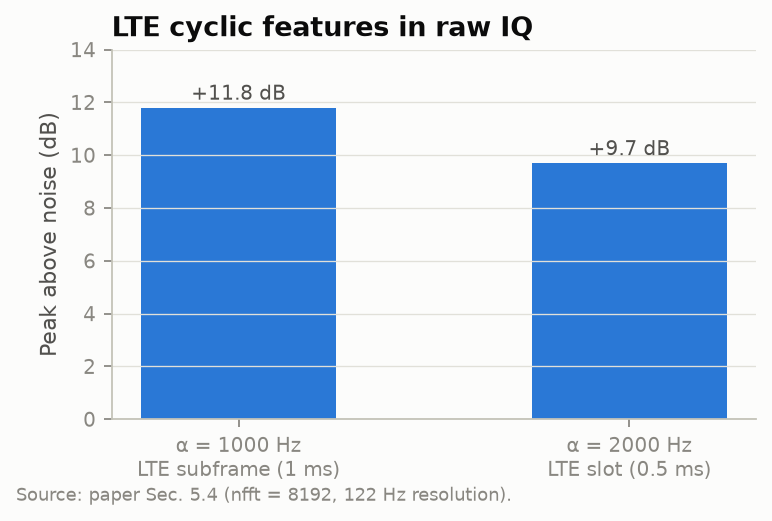

# Results

This page has two parts. Part A contains **measured** results from POWDER, as published in the INDOP paper. Part B contains **synthetic** results from this repository's simulator, which motivate and design the INDOP-MA experiments. Do not mix the two when you cite numbers.

---

## A. Measured (POWDER, CBRS 3595 MHz)

### A1. Multi-node evaluation, July 2026 (paper Table 3)

| Node | INDOP (%) | GT (%) | Gap (pp) | Within ±2.5 pp |
|---|---:|---:|---:|:-:|
| Sagepoint † | 17.7 | 19.1 | −1.4 | ✓ |
| Web | 36.5 | 38.9 | −2.4 | ✓ |
| Guesthouse | 27.5 | 22.4 | +5.1 | ✗ |
| Moran | 21.2 | 18.7 | +2.5 | ✓ |
| Madsen | 31.2 | 29.2 | +2.0 | ✓ |

* **4 of 5 validated nodes are within ±2.5 pp.** The mean absolute gap is 2.7 pp over all five nodes and 2.1 pp without Guesthouse.
* **No node uses a calibration table for INDOP itself.** Only the GT comparison needs calibration, and that calibration is exact only for Sagepoint (†).
* **The spread of occupancy across nodes (17.7–36.5 %) is far larger than the INDOP error.** This is real spatial structure in the band, and it is what a location-aware DST should capture.
* **Law73 and EBC** were deployed but are not yet validated.

### A2. Single-node validation (paper Tables 1, 2 and 4; Sec. 5.4)

| | |
|---|---|
|  |  |
|  |  |

* **Method comparison.** INDOP's anchor GMM is −1.4 pp from GT, HMM hard −1.2 pp and HMM soft +1.1 pp. The DySPAN percentile baseline is −19.0 pp, and a full-capture GMM at 3σ is +5.1 pp.
* **Anchor window.** The gap stays small up to 72 s. B210 drift between 72 and 90 s pushes it to +23 pp.
* **Physics consistency.** The physics GT threshold for serial 31722B7, recomputed in `indop/ground_truth.py`, is −116.995 dBX. The anchor GMM finds −116.996 dBX with no calibration.
* **Cyclostationary confirmation.** The LTE features stand +11.8 dB above noise at α = 1 kHz and +9.7 dB at 2 kHz.

---

## B. Synthetic (simulator, INDOP-MA design studies)

The simulator assumptions are documented in [METHODOLOGY.md](METHODOLOGY.md#synthetic-scenario-simsyntheticpy). The raw outputs are in `results/*.csv|json`.

### B1. Noise-floor consensus (`results/consensus_synthetic.csv`)

Gap at the faulty node, median over 10 seeds:

| Anchor bias b | No consensus | Absolute, σ_u = 0.02 dB | Absolute, σ_u = 0.3 dB | **Offset, σ_u = 0.3 dB** | 2.5σ guard |
|---:|---:|---:|---:|---:|---:|
| 0.00 dB | −1.9 | −2.3 | −1.9 | **−1.9** | −5.9 |
| 0.04 dB | +2.2 | +2.1 | +2.2 | **+1.1** | −3.2 |
| 0.06 dB | +5.0 | +5.0 | +5.0 | **−0.2** | −1.4 |
| 0.08 dB | +8.5 | +3.6 | +8.5 | **−1.6** | +0.3 |
| 0.10 dB | +12.8 | +4.3 | +12.8 | **−1.7** | +2.7 |

Low-SNR overlap (same metric):

| SNR | No consensus | Offset consensus | 2.5σ guard |
|---:|---:|---:|---:|
| −6 dB | −3.2 | −3.2 | −5.8 |
| −9 dB | +4.5 | +4.5 | −4.4 |
| −12 dB | +19.6 | +19.6 | −0.6 |

**Conclusion.** Offset consensus is the right fix for an unlucky anchor window. A far, low-SNR node needs a separation guard instead, applied only when the GMM separation is small. The decision table in [EXPERIMENTS.md](EXPERIMENTS.md#e2-noise-floor-consensus-and-the-guesthouse-51-pp-anomaly) uses this to tell which mechanism is behind the real Guesthouse gap.

### B2. Fusion rules (`results/fusion_synthetic.csv`)

| Rule | False grant | Missed detection | False denial | Utilisation |
|---|---:|---:|---:|---:|
| OR | 0.0 % | 0.2 % | 10.9 % | 89.1 % |
| Majority 4/7 | 3.9 % | 10.1 % | 4.1 % | 95.9 % |
| AND | 45.6 % | 54.1 % | 0.3 % | 99.7 % |
| Weighted IDW τ = 0.5 | 5.2 % | 13.2 % | 3.0 % | 97.0 % |
| Weighted IDW τ = 0.3 | 1.6 % | 6.4 % | 5.4 % | 94.6 % |

### B3. Spatial maps (`results/spatial_map_synthetic.json`)

| Estimator | Map MAE | Map RMSE | Node MAE |
|---|---:|---:|---:|
| INDOP-MA: 7 agents, 100 ms, GP | **2.5 pp** | **3.5 pp** | **1.9 pp** |
| Fixed threshold on 3 s sweeps, GP | 7.4 pp | 11.8 pp | 27.0 pp |

### B4. Cooperative cyclostationary detection (`results/coop_cyclo_synthetic.csv`)

| Per-node SNR | 1 node | 3 nodes | 7 nodes |
|---:|---:|---:|---:|
| −18 dB | 0.22 | 0.42 | 0.53 |
| −16 dB | 0.50 | 0.88 | **1.00** |
| −14 dB | **0.95** | 1.00 | 1.00 |

These are detection probabilities at P_fa = 5 %. Averaging across seven nodes gains about 2–3 dB in the SNR needed for reliable LTE confirmation.

### B5. 24-hour temporal campaign (`results/temporal_campaign_synthetic.csv`)

* INDOP flags **hours 04, 05 and 06** as idle on all seven nodes. This matches the simulated cooperating-carrier window exactly, with at most 0.06 % residual occupancy.
* The network-mean occupancy tracks the truth across the day.
* Isolated node-hours over-estimate by up to about 12 pp. The worst case is the 10:00 session, where one node reads 43.8 % against a true maximum of 31.7 %. Outliers like this are the kind E2's consensus is designed to catch; whether it does is not yet measured.
